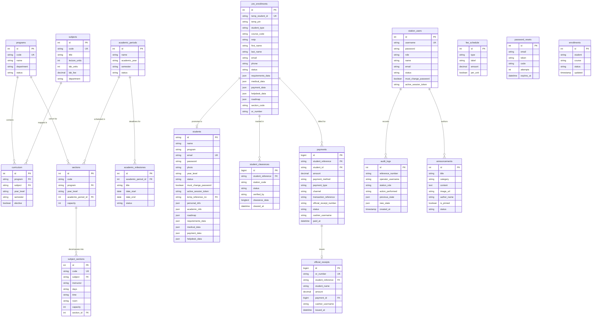

# ACADEMIC & ENROLLMENT MANAGEMENT SYSTEM
## Comprehensive System Analysis & BSIS/BSIT Technical Documentation Report

**Institution:** Go-on National College of the Philippines (GNCP) — Dasmariñas Campus  
**Project Identifier:** `gncp-academic-system` (`systemtest`)  
**Document Classification:** Formal Technical System Analysis & Software Engineering Audit Report  
**Target Curriculum:** Bachelor of Science in Information Systems (BSIS) / Information Technology (BSIT)  
**Date of Technical Audit:** September 29, 2026  
**Auditor / Engineering Analyst:** Antigravity AI Senior Systems Architecture & Cybersecurity Audit Agent  
**Audit Protocol:** Static Source Code Tracing, Architectural Modeling, Dynamic Schema Mapping, and Security Review (Zero-Modification Verification Mode)  

---

## Table of Contents

- [I. Executive Summary](#i-executive-summary)
- [II. System Overview](#ii-system-overview)
- [III. Existing System Architecture](#iii-existing-system-architecture)
- [IV. User Roles and Responsibilities](#iv-user-roles-and-responsibilities)
- [V. Functional Modules](#v-functional-modules)
- [VI. System Workflows](#vi-system-workflows)
- [VII. Complete Data Flow Analysis](#vii-complete-data-flow-analysis)
- [VIII. Database Structure & Relational Analysis](#viii-database-structure--relational-analysis)
- [IX. API & Middleware Structure](#ix-api--middleware-structure)
- [X. Security Analysis & Vulnerability Review](#x-security-analysis--vulnerability-review)
- [XI. Requirements Traceability Matrix](#xi-requirements-traceability-matrix)
- [XII. Current System Issues & Defect Catalog](#xii-current-system-issues--defect-catalog)
- [XIII. Technical Debt Analysis](#xiii-technical-debt-analysis)
- [XIV. Strengths of the Current System](#xiv-strengths-of-the-current-system)
- [XV. System Limitations](#xv-system-limitations)
- [XVI. Strategic Recommendations](#xvi-strategic-recommendations)
- [XVII. Overall System Assessment](#xvii-overall-system-assessment)

---

## I. Executive Summary

The **Go-on National College of the Philippines (GNCP) Academic, Admissions & Workstation Enrollment System** is an enterprise-grade academic management software platform. It is engineered to digitize, coordinate, and accelerate the collegiate student onboarding lifecycle across higher education degree programs (e.g., BS Information Technology, BS Computer Science, BS Computer Engineering, BS Nursing, and BS Business Administration).

Prior to this software implementation, collegiate admissions and enrollment suffered from traditional physical queue bottlenecks, manual document verification delays, disparate spreadsheet tracking, human calculation errors in credit-unit tuition assessments, and uncoordinated physical handover between student-support offices. The GNCP system addresses these organizational challenges by introducing a **decoupled physical workstation architecture** supported by a centralized REST API gateway, an automated multi-station finite-state machine (FSM), real-time background queue synchronization, deterministic institutional fee assessment rules, and automated student identity provisioning.

This comprehensive technical report provides an exhaustive, evidence-based architectural, functional, data-flow, database, security, and quality audit of the entire codebase located at `c:\xampp\htdocs\systemtest`. Every architectural observation, data-flow diagram, and technical finding documented herein is derived directly from physical source code files, database schemas, and configuration scripts without altering any application state.

---

## II. System Overview

### 2.1 System Purpose & Problem Addressed
In higher education institutions in the Philippines, enrollment periods typically overwhelm administrative staff due to high student volume and complex multi-department clearance prerequisites. Students must physically queue across Admissions, the Registrar, Academic Deans/Advisers, the Medical Clinic, the Cashier, and the IT Center. Manual synchronization leads to:
1. Long waiting times and physical congestion.
2. Inconsistent student records across departmental spreadsheets.
3. Billing discrepancies in per-unit tuition, laboratory fees, miscellaneous charges, NSTP components, and installment plan surcharges.
4. Delay in establishing official student portal access and institutional email accounts.

The GNCP Academic Management System resolves these challenges by introducing an end-to-end digital pipeline that manages:
- **Public Online Intake:** Prospective freshmen and transferees submit demographic and academic information via a guided online registration wizard.
- **Sequential Workstation Clearance:** On-campus operators at specialized physical stations process applications through a deterministic state machine (`PRE_REGISTERED` $\rightarrow$ `VERIFIED` $\rightarrow$ `ADVISED` $\rightarrow$ `MEDICAL_CLEARED` $\rightarrow$ `PAID` $\rightarrow$ `ENROLLED`).
- **Deterministic Fee Calculations:** Authoritative billing calculations derived from database-driven fee schedules with frozen assessment snapshots upon academic advising.
- **Identity Promotion & Self-Service:** Automated migration of verified staging applicants into the permanent student directory with permanent student IDs, institutional email accounts, and secure portal access.

### 2.2 Target Users & Stakeholders
The system serves four primary stakeholder categories:
1. **Prospective Applicants & Transferees:** Individuals applying for collegiate admission who register online, upload required documents, and track their admission roadmap using temporary tracking credentials.
2. **Returning / Enrolled Students:** Bonafide collegiate students who utilize the Student Self-Service Portal to inspect their Certificate of Registration (COR), weekly class schedules, account ledgers, campus bulletins, and academic calendars.
3. **Station Operators (Administrative Staff):** Specialized desk officers operating dedicated workstation interfaces:
   - *Registrar Officers:* Review academic credentials, verify original documents, and evaluate eligibility.
   - *TLC Helpdesk Advisers:* Advise students, assign curriculum blocks, lock NSTP components, and freeze assessments.
   - *Clinic Medical Staff:* Conduct physical examinations and stamp fitness clearances.
   - *Cashier Officers:* Validate fees, accept cash or online downpayments, issue Official Receipts (OR), and print CORs.
   - *IT Center Officers:* Capture webcam portrait photos, provision permanent student accounts, and dispatch credentials.
4. **Institutional Administrators & Developers:**
   - *Super Administrators:* Manage institutional academic catalogs (programs, subjects, curriculums), section schedules, academic terms, operator accounts, and institutional announcements.
   - *System Developers / Security Officers:* Monitor live traffic radar, telemetry, active firewall rules, and rate limits.

### 2.3 Major Functions
- **Online Admissions Wizard:** 5-step responsive application form capturing demographic, academic, and medical histories.
- **Application Roadmap Tracker:** Real-time visual milestone tracker accessible via Reference Number and 6-digit PIN.
- **Document Management Subsystem:** Multi-document upload portal with strict PDF magic-byte validation and anti-polyglot scanning.
- **Multi-Station Workstation Queue:** Real-time queue boards synchronized via background ETag HTTP 304 polling.
- **Academic Advising & Block Sectioning:** Dynamic prospectus scoping, subject unit evaluation, and section capacity management.
- **Financial Assessment & Cashiering Engine:** Automated credit-unit billing, flat miscellaneous fee calculation, 8% installment surcharge computation, Official Receipt (OR) ledger tracking, and PayMongo payment gateway integration.
- **IT Account Promotion Engine:** Automated sequential student ID generation (`YYYY-XXXX`), institutional email synthesis, bcrypt password hashing, and staging-to-permanent directory migration.
- **Student Academic Self-Service (SAS) Portal:** Authenticated student portal for viewing official CORs, weekly schedules, financial balances, and campus announcements.
- **Super Admin Control Center:** Institutional academic catalog CRUD, cohort section generator, academic term cloning, staff provisioning, and university milestone management.
- **Threat Radar & Traffic Telemetry Console:** Real-time SOC dashboard for client IP tracking, active rate-limit monitoring, and firewall IP banning.

### 2.4 System Boundaries
- **Inside System Scope:** All student onboarding workflows, physical workstation evaluations, academic catalog management, cohort scheduling, fee calculation, receipt generation, student portal operations, and system security telemetry.
- **Outside System Scope (External Handled):** Native mobile applications (system is web-responsive only), physical hardware cash drawers, physical access turnstiles, and direct banking core integration (external payments simulated or mediated via PayMongo API).

---

## III. Existing System Architecture

### 3.1 Architecture Overview
The GNCP system is architected as a **modular service-oriented web monolithic application** utilizing a **Dual-Gateway REST API** backend paired with a **Vue 3 Progressive Enhancement** frontend. It avoids heavy single-page application (SPA) Node.js compilation build steps, enabling rapid zero-build deployment on standard Apache/PHP/MariaDB stacks (such as XAMPP or Linux/cPanel/InfinityFree environments).

```mermaid
graph TD
    Client["Client Web Browser<br/>(Desktop / Tablet / Mobile)"]
    
    subgraph PresentationLayer["Presentation Layer (Client-Side)"]
        VueApp["Vue 3 Runtime (CDN Progressive Enhancement)"]
        DesignTokens["Shared CSS Tokens & Typography (Outfit / Open Sans)"]
        DataBus["StationDataBus.js (Event Stream & LocalStorage Sync)"]
    end

    subgraph GatewayLayer["API & Routing Gateway"]
        CanonicalAPI["api/index.php (Canonical REST Gateway + X-Request-ID)"]
        LegacyAPI["Legacy Local Station Adapters (stations/backend/api.php, etc.)"]
        WAF["security_guard.php (Scanner & Exploit Firewall)"]
        RateLimit["rate_limit.php (Atomic File-Based Throttle)"]
        SessionGuard["session_guard.php (Single-Active Token & RBAC)"]
    end

    subgraph ServiceLayer["Business Logic Layer (PHP 8.2 Services)"]
        AuthService["AuthController.php / UserModel.php"]
        StudentService["StudentController.php / StudentModel.php"]
        StationService["StationController.php / EnrollmentService.php"]
        FinanceService["AssessmentService.php / PaymentService.php / PayMongoService.php"]
        CatalogService["CatalogAdminController.php / SectionService.php"]
        AdminService["AdminController.php / UserAdminController.php"]
        EmailService["EmailService.php / SocketSmtpTransport.php"]
        TelemetryService["telemetry.php / logger.php"]
    end

    subgraph DatabaseLayer["Database Layer (MariaDB 10.4+ / InnoDB)"]
        StagingDB[("pre_enrollments (Staging Application Queue)")]
        PermanentDB[("students (Permanent Student Directory)")]
        UsersDB[("station_users (Staff & Admin Accounts)")]
        FinancialDB[("payments & official_receipts (Financial Ledgers)")]
        AcademicDB[("programs, subjects, curriculum, sections, fee_schedule")]
        AuditDB[("audit_logs & student_clearances")]
    end

    Client --> PresentationLayer
    PresentationLayer --> GatewayLayer
    GatewayLayer --> ServiceLayer
    ServiceLayer --> DatabaseLayer
```



### 3.2 Frontend Architecture
- **Framework & Component Model:** Progressive enhancement via Vue 3 (`shared/libs/vue.global.js`). Each portal view mounts a local reactive Vue instance (`Vue.createApp({...}).mount('#app')`) directly to server-rendered HTML.
- **Styling Architecture:** High-legibility design token system defined in [`shared/css/admin_workstation_theme.css`](file:///c:/xampp/htdocs/systemtest/shared/css/admin_workstation_theme.css), enforcing institutional color palettes:
  - GNCP Forest Green: `#006A4E` (`--primary-green`)
  - Deep Botanical Green: `#003D2B` (`--dark-green`)
  - Mint Surface Tint: `#e6f4ed` (`--light-accent-green`)
  - Academic Gold: `#D4AF37` / `#FCD34D` (`--gold`, `--gold-light`)
- **Shared Navigation:** [`shared/js/components/EmployeeSidebar.js`](file:///c:/xampp/htdocs/systemtest/shared/js/components/EmployeeSidebar.js) provides a universal, responsive navigation drawer across all station and administrative portals.
- **Client Synchronization:** [`stations/assets/js/StationDataBus.js`](file:///c:/xampp/htdocs/systemtest/stations/assets/js/StationDataBus.js) maintains a 3-second background polling loop comparing local cached queue state (`localStorage`) against server ETag hashes, triggering reactive DOM updates via `window.dispatchEvent(new Event('storage'))`.

### 3.3 Backend Architecture
- **Runtime Environment:** PHP 8.2+ executing on Apache 2.4.x.
- **Dual-Gateway Routing:**
  1. *Canonical REST Gateway:* [`api/index.php`](file:///c:/xampp/htdocs/systemtest/api/index.php) handles all modern REST routes, injects `X-Request-ID` correlation headers, enforces rate limits, logs structured telemetry, and delegates execution to modular controllers.
  2. *Legacy Compatibility Adapters:* Local station routers (e.g. `stations/backend/api.php`, `registrar/backend/api.php`, `student-portal/backend/api.php`) provide backward compatibility for older views by proxying requests to central domain services.
- **Service Decomposition:** Business logic is encapsulated in modular PHP classes in `shared/backend/services/` and `stations/backend/services/` (such as `AssessmentService`, `EnrollmentService`, `QueueService`, `StudentPortalService`), adhering to Single Responsibility bounds (<250 lines per file for specialized services).

### 3.4 Database Architecture
- **Engine & Storage:** MariaDB 10.4+ / MySQL 8.x using the `InnoDB` storage engine for ACID transaction support (`$pdo->beginTransaction()`, `$pdo->commit()`, `$pdo->rollBack()`).
- **Connection Singleton:** Strictly managed through [`shared/backend/config/database.php`](file:///c:/xampp/htdocs/systemtest/shared/backend/config/database.php) (`Database::getInstance()`), enforcing UTF8MB4 character sets and `PDO::ERRMODE_EXCEPTION`.
- **Dual-Table Persistence Strategy:** Separates temporary onboarding applications (`pre_enrollments`) from permanent institutional student accounts (`students`), preventing unverified applicants from cluttering the official academic directory.

### 3.5 Middleware & Security Layer
- **WAF & Threat Inspection:** [`shared/backend/utils/security_guard.php`](file:///c:/xampp/htdocs/systemtest/shared/backend/utils/security_guard.php) intercepts automated security scanning tools (SQLmap, Nikto, Gobuster), blocks directory traversal sequences (`../`), inspects PHP wrappers, and injects strict security headers (CSP, HSTS, X-Frame-Options).
- **Session & Concurrency Guard:** [`shared/backend/utils/session_guard.php`](file:///c:/xampp/htdocs/systemtest/shared/backend/utils/session_guard.php) enforces a 2-hour idle timeout, validates cross-site request forgery (CSRF) tokens, and verifies single-active session tokens against MariaDB to prevent account sharing or concurrent browser logins.
- **Rate Limiting:** [`shared/backend/utils/rate_limit.php`](file:///c:/xampp/htdocs/systemtest/shared/backend/utils/rate_limit.php) prevents brute-force credential stuffing and denial-of-service attempts using file-based atomic locks.

---

## IV. User Roles and Responsibilities

The system defines 8 distinct user roles across administrative, operator, and student tiers.

| Role Name | Purpose | Accessible Modules | Key Permissions | System Restrictions | Main Workflows | View | Create | Update | Delete | Approve / Reject | Status in Code |
| :--- | :--- | :--- | :--- | :--- | :--- | :--- | :--- | :--- | :--- | :--- | :--- |
| **SUPER_ADMIN** | Full institutional governance & administration | `admin/`, `monitoring/`, all workstation views | Unrestricted access across all modules, catalog management, user provisioning | Cannot delete own active account | Academic term setup, catalog editing, user management, audit review | All data | All data | All data | All data | Full authority | **Fully Implemented** |
| **ADMIN** | Administrative supervisor | `admin/`, all workstation views | Program/subject editing, cohort scheduling, operator password resets | Cannot delete or demote Super Admin accounts | Academic setup, section cohort generation, operator management | All data | Programs, Subjects, Sections, Terms, Staff | Programs, Subjects, Sections, Terms, Staff | Non-admin users, sections | Full authority | **Fully Implemented** |
| **REGISTRAR** | Document verification & admissions eligibility | `registrar/index.html`, `index.html` | Review pending applications, verify/reject document requirements, assign sections | Cannot process cashier payments or activate IT accounts | Stage 1 verification, document requirement checklist, section tagging | Staging applications, requirements, student records | Registrar notes, requirement checks | Application status (`VERIFIED`/`REJECTED`) | None | Can `VERIFY` or `REJECT` applications | **Fully Implemented** |
| **HELPDESK** | Academic advising & curriculum unit evaluation | `stations/tlc-helpdesk/`, `index.html` | Advise enrolled subjects, evaluate unit loads, lock NSTP component, apply scholarships | Cannot verify registrar documents or issue cashier receipts | Stage 2 academic advising, NSTP selection, assessment snapshot freezing | Verified applicant queue, curriculum prospectus, sections | Advised subject lists, scholarship tags | Application status (`ADVISED`), section assignment | None | Can mark Advising as `COMPLETED` | **Fully Implemented** |
| **MEDICAL** | Clinic health examination & fitness clearance | `stations/medical-checkup/`, `index.html` | Record vital signs, physical exam notes, health declarations, medical fitness clearance | Cannot modify academic subjects, tuition fees, or portal accounts | Stage 3 health screening, physical examination clearance | Advised applicant queue, medical history | Physical examination vitals, doctor notes | Application status (`MEDICAL_CLEARED`), fitness status | None | Can clear (`FIT` / `CONDITIONAL`) or flag (`UNFIT`) | **Fully Implemented** |
| **CASHIER** | Tuition billing, payment collection & receipting | `stations/payment-processing/`, `index.html` | Verify frozen assessment snapshots, accept cash/online payments, issue OR numbers, print COR | Cannot accept payments for `PRE_REGISTERED` or `REJECTED` applicants; cannot advise | Stage 4 tuition payment collection, OR ledger recording, COR generation | Medically cleared queue, assessment breakdown, payment history | Official receipts (`official_receipts`), payments | Application status (`PAID`), payment records | None | Can approve payment transaction | **Fully Implemented** |
| **IT_CENTER** | Identity provisioning & student directory promotion | `stations/it-center/`, `index.html` | Capture webcam portrait photo, generate permanent Student ID, promote applicant to permanent student | Cannot alter cashier billing or medical clearance notes | Stage 5 final promotion, portrait ID upload, credentials dispatch | Paid applicant queue, promoted student directory | Permanent student record, institutional email | Application status (`ENROLLED`), student accounts | None | Can finalize and promote enrollment | **Fully Implemented** |
| **STUDENT** | Enrolled student self-service | `student-portal/index.html`, `login.html` | View COR, weekly class schedules, financial ledger, milestones, campus bulletins | Restricted exclusively to own student record; cannot view other students | Password reset, profile update (emergency contacts, photo), document viewing | Own academic record, schedule, COR, billing | Document uploads (transcripts, birth certs) | Own contact details, own password | None | None | **Fully Implemented** |
| **DEVELOPER** | Telemetry, traffic radar & security operations | `monitoring/index.html`, `index.html` | Inspect live request radar, top client IPs, active rate limits, manage IP firewall blacklist | Cannot alter academic catalogs, grades, or cashier transactions | System health monitoring, threat analysis, IP blocking/unblocking | Telemetry logs, rate limits, banned IPs, system health | Firewall ban rules | Rate limit clears, firewall rules | Banned IP records | None | **Fully Implemented** |

---

## V. Functional Modules

```
┌──────────────────────────────────────────────────────────────────────────────────────────────────┐
│                                   GNCP SYSTEM MODULE TOPOLOGY                                    │
├─────────────────────────┬───────────────────────────────┬────────────────────────────────────────┤
│     PUBLIC INTAKE       │     WORKSTATION CLEARANCES    │       ADMIN & STUDENT SERVICES         │
├─────────────────────────┼───────────────────────────────┼────────────────────────────────────────┤
│ 1. Public Web Portal    │ 4. Registrar Workstation      │ 9. Student Self-Service (SAS) Portal   │
│ 2. Pre-Enrollment Wizard│ 5. TLC Advising Helpdesk      │ 10. Super Admin Master Console         │
│ 3. Status Roadmap Track │ 6. Clinic Medical Screening   │ 11. Threat Radar & SOC Console         │
│                         │ 7. Cashier Billing Desk       │ 12. Central REST Engine & WAF          │
│                         │ 8. IT Center Promotion Desk   │ 13. Financial Calculation Engine       │
└─────────────────────────┴───────────────────────────────┴────────────────────────────────────────┘
```

### Module 1: Public Institutional Web Portal
- **Purpose:** Public presentation of collegiate programs, institutional overview, and admissions navigation.
- **Users / Roles:** General Public, Prospective Students.
- **Main Features:** Degree program overview, admission requirements summary, campus virtual showcase, and deep-links to the online enrollment wizard.
- **Inputs:** Navigation clicks.
- **Processing:** Client-side HTML rendering.
- **Outputs:** Responsive college landing page.
- **Database Tables Used:** None (Static presentation).
- **API Endpoints Used:** None.
- **Dependencies:** Bootstrap 5.3, FontAwesome.
- **Current Status:** **Fully Implemented** (`school-website/index.html`).

### Module 2: Online Pre-Enrollment Registration Wizard
- **Purpose:** Intake applicant demographic, academic, and health information.
- **Users / Roles:** Prospective Freshmen, Transferees, Returning Students.
- **Main Features:** 5-step reactive wizard (Program Selection, Personal Info, Academic History, Health Declaration, Review), returning student lookup via institutional email, client-side validation.
- **Inputs:** Student full name, birth date, gender, address, phone, email, SHS track, previous schools, emergency contact, selected program.
- **Processing:** Validates required fields, checks rate limits (max 5 submissions / 60s per IP), generates tracking reference (`REF-YYYY-XXXX`) and 6-digit numeric PIN, stores records in `pre_enrollments`.
- **Outputs:** Printable registration voucher with QR code, Reference Number, and temporary PIN.
- **Database Tables Used:** `pre_enrollments`, `programs`, `academic_periods`.
- **API Endpoints Used:** `POST /api/index.php?action=student/register`, `GET /enrollment-system/backend/register.php?action=get_active_programs`.
- **Dependencies:** `StudentController.php`, `StudentModel.php`, `rate_limit.php`.
- **Current Status:** **Fully Implemented** (`enrollment-system/index.html`).

### Module 3: Real-Time Application Roadmap Tracker
- **Purpose:** Enable applicants to independently monitor their admission clearance progress.
- **Users / Roles:** Applicants, Parents.
- **Main Features:** Authenticated status lookup using Reference Number and PIN, visual 6-stage roadmap tracker, assigned block section indicator, soft-copy document uploader.
- **Inputs:** Reference Number (`REF-2026-XXXX`), 6-digit PIN.
- **Processing:** Validates PIN against `pre_enrollments.temp_pin` (or fallback `students.temp_reference_no`), returns sanitized roadmap stages, masks applicant name for data privacy.
- **Outputs:** Interactive status board showing completed, in-progress, and locked workstations.
- **Database Tables Used:** `pre_enrollments`, `students`.
- **API Endpoints Used:** `GET /api/index.php?action=student/track`, `GET /api/index.php?action=student/documents`, `POST /api/index.php?action=student/upload_document`.
- **Dependencies:** `StudentController.php`, `session_guard.php`.
- **Current Status:** **Fully Implemented** (`enrollment-system/tracker.html`).

### Module 4: Registrar Verification Workstation
- **Purpose:** On-campus evaluation of submitted physical credentials and admission eligibility.
- **Users / Roles:** `REGISTRAR`, `ADMIN`, `SUPER_ADMIN`.
- **Main Features:** Real-time applicant queue board, document checklist verification (Form 138, Good Moral, PSA Birth Certificate), status transitions (`VERIFIED`, `REJECTED`), applicant remarks, cohort section allocation.
- **Inputs:** Status selection (`VERIFIED` / `REJECTED`), document verification checkboxes, officer notes.
- **Processing:** Updates `pre_enrollments.requirements_data`, advances `roadmap[1]` to `COMPLETED`, records operator audit log, unlocks TLC Helpdesk queue.
- **Outputs:** Updated application status, synchronized queue stream.
- **Database Tables Used:** `pre_enrollments`, `audit_logs`, `student_clearances`.
- **API Endpoints Used:** `POST /api/index.php?action=registrar/update_status`, `POST /api/index.php?action=registrar/verify_document`, `GET /api/index.php?action=stations/queue`.
- **Dependencies:** `RegistrarService.php`, `StationController.php`, `StationDataBus.js`.
- **Current Status:** **Fully Implemented** (`registrar/index.html`).

### Module 5: TLC Helpdesk & Academic Advising Workstation
- **Purpose:** Academic unit evaluation, course subject advising, and NSTP component lock-in.
- **Users / Roles:** `HELPDESK`, `ADMIN`, `SUPER_ADMIN`.
- **Main Features:** Prospectus subject scoping for active term, NSTP track assignment (CWTS / ROTC), scholarship voucher application, cohort block sectioning, automated assessment snapshot freezing.
- **Inputs:** Selected cohort section, advised subject toggles, NSTP selection, scholarship grant type.
- **Processing:** Validates curriculum requirements, computes tuition units, freezes billing snapshot via `AssessmentService::calculateAssessment()`, advances status to `ADVISED`.
- **Outputs:** Frozen assessment breakdown, advised subjects array in `helpdesk_data`.
- **Database Tables Used:** `pre_enrollments`, `curriculum`, `subjects`, `sections`, `fee_schedule`.
- **API Endpoints Used:** `POST /api/index.php?action=stations/update`, `GET /api/index.php?action=stations/queue`.
- **Dependencies:** `AssessmentService.php`, `EnrollmentService.php`, `ProspectusScopingService.php`.
- **Current Status:** **Fully Implemented** (`stations/tlc-helpdesk/index.html`).

### Module 6: Medical Clinic Screening Workstation
- **Purpose:** Health screening and physical fitness evaluation.
- **Users / Roles:** `MEDICAL`, `ADMIN`, `SUPER_ADMIN`.
- **Main Features:** Medical history declaration review, vital signs encoding (BP, pulse, height, weight), physical exam clearance stamping (`FIT`, `CONDITIONAL`, `UNFIT`), clinic notes.
- **Inputs:** Vital signs, fitness status, medical notes.
- **Processing:** Saves clinical record into `pre_enrollments.medical_data`, inserts clinic clearance into `student_clearances`, advances status to `MEDICAL_CLEARED`.
- **Outputs:** Medical fitness certificate, clearance badge.
- **Database Tables Used:** `pre_enrollments`, `student_clearances`, `audit_logs`.
- **API Endpoints Used:** `POST /api/index.php?action=stations/update`.
- **Dependencies:** `EnrollmentService.php`, `StationDataBus.js`.
- **Current Status:** **Fully Implemented** (`stations/medical-checkup/index.html`).

### Module 7: Cashier Billing & Tuition Collection Workstation
- **Purpose:** Fee schedule validation, tuition downpayment collection, Official Receipt issuance.
- **Users / Roles:** `CASHIER`, `ADMIN`, `SUPER_ADMIN`.
- **Main Features:** Frozen assessment snapshot verification, payment mode selection (`FULL_CASH`, `INSTALLMENT`), payment transaction logging, auto-generation of sequential Official Receipt (OR) numbers, PayMongo online payment simulation, Certificate of Registration (COR) generation.
- **Inputs:** Amount paid, payment method (`CASH`, `GCASH`, `PAYMONGO`), payment channel, OR Number.
- **Processing:** Checks payment eligibility (rejects unverified/unadvising applicants), updates `pre_enrollments.payment_data`, inserts record into `payments` and `official_receipts`, advances status to `PAID`.
- **Outputs:** Printable Official Cashier Receipt (`receipt_print.php`), printable COR (`cor_print.php`).
- **Database Tables Used:** `pre_enrollments`, `payments`, `official_receipts`, `student_clearances`, `fee_schedule`.
- **API Endpoints Used:** `POST /api/index.php?action=stations/update`, `POST /api/index.php?action=payments/paymongo_simulate_paid`.
- **Dependencies:** `AssessmentService.php`, `PaymentService.php`, `EnrollmentService.php`.
- **Current Status:** **Fully Implemented** (`stations/payment-processing/index.html`).

### Module 8: IT Center Identity & Account Promotion Workstation
- **Purpose:** Final identity verification, webcam portrait photo capture, permanent account provisioning.
- **Users / Roles:** `IT_CENTER`, `ADMIN`, `SUPER_ADMIN`.
- **Main Features:** WebRTC webcam photo capture, collision-free permanent Student ID generation (`YYYY-XXXX`), institutional email synthesis, bcrypt temporary password generation, staging-to-permanent student migration, section capacity decrementing, automated email credential dispatch.
- **Inputs:** Captured portrait Base64 image, assigned section confirmation.
- **Processing:** Executes atomic MariaDB transaction: migrates `pre_enrollments` row into `students` table, sets status to `ENROLLED`, marks staging row as `PROMOTED`, decrements capacity in `subject_sections`, dispatches welcome email.
- **Outputs:** Permanent student record, printable student ID card, institutional credentials.
- **Database Tables Used:** `pre_enrollments`, `students`, `subject_sections`, `audit_logs`, `student_clearances`.
- **API Endpoints Used:** `POST /api/index.php?action=stations/update`, `POST /api/index.php?action=stations/upload_photo`, `GET /api/index.php?action=stations/next_student_id`.
- **Dependencies:** `EnrollmentService.php`, `student.php`, `EmailService.php`.
- **Current Status:** **Fully Implemented** (`stations/it-center/index.html`).

### Module 9: Student Academic Self-Service (SAS) Portal
- **Purpose:** Authenticated student portal for academic schedules, billing balances, and institutional bulletins.
- **Users / Roles:** `STUDENT`.
- **Main Features:** Student login with single-active session enforcement, forced password change on initial login, official printable COR, weekly visual class timetable, financial payment ledger with running balance, student document uploader, campus announcements, and academic milestones calendar.
- **Inputs:** Student ID, password, new password, uploaded documents (PDF), updated contact details.
- **Processing:** Authenticates bcrypt hash, establishes `$_SESSION['gncp_student']`, generates single-active session token, loads advising and assessment data, logs out old sessions.
- **Outputs:** Complete academic dashboard, printable COR, schedule grid.
- **Database Tables Used:** `students`, `announcements`, `academic_milestones`, `password_resets`, `payments`.
- **API Endpoints Used:** `POST /api/index.php?action=student_portal/login`, `GET /api/index.php?action=student_portal/dashboard`, `POST /api/index.php?action=student_portal/change_password`, `POST /api/index.php?action=student_portal/upload_document`.
- **Dependencies:** `StudentPortalService.php`, `StudentPortalController.php`, `session_guard.php`.
- **Current Status:** **Fully Implemented** (`student-portal/index.html`).

### Module 10: Super Admin Master Management Console
- **Purpose:** Centralized administrative control of institutional academic data, users, and bulletins.
- **Users / Roles:** `SUPER_ADMIN`, `ADMIN`.
- **Main Features:** University analytics dashboard, Academic Catalog CRUD (Degree Programs, Subjects, Curriculum maps), Cohort Section Generator, Academic Terms (cloning terms, active semester toggle), Fee Schedule configuration, Station Operator account management (CRUD, status activation, password reset, temporary credentials email dispatch), Campus Announcements authoring with image uploads, and Academic Milestones scheduler.
- **Inputs:** Academic codes, titles, unit values, fees, user accounts, announcement markdown/HTML.
- **Processing:** Validates unique program/subject codes, enforces bcrypt hashing on user creation, logs administrative audit events.
- **Outputs:** Real-time analytics, updated catalogs, operator credentials.
- **Database Tables Used:** `programs`, `subjects`, `curriculum`, `sections`, `subject_sections`, `academic_periods`, `fee_schedule`, `station_users`, `announcements`, `academic_milestones`, `audit_logs`.
- **API Endpoints Used:** `api/index.php?action=admin/*` (analytics, catalog, sections, terms, users, announcements, milestones).
- **Dependencies:** `AdminController.php`, `CatalogAdminController.php`, `ScheduleAdminController.php`, `UserAdminController.php`.
- **Current Status:** **Fully Implemented** (`admin/index.html`).

### Module 11: Threat Radar & Security Operations Center (SOC) Console
- **Purpose:** Real-time security telemetry, traffic analysis, and firewall management.
- **Users / Roles:** `DEVELOPER`, `SUPER_ADMIN`.
- **Main Features:** Real-time HTTP request radar with status codes and latency metrics, top client IP analytics, active rate-limit inspection, firewall IP banning and unbanning, server system health metrics (PHP version, memory usage, DB status, log sizes).
- **Inputs:** Polling interval selector (1s, 3s, 5s, 10s), IP ban inputs (IP address, reason, duration).
- **Processing:** Reads structured telemetry logs (`shared/backend/logs/telemetry.log`), manages banned IP JSON blacklist (`shared/backend/config/ip_blacklist.json`), clears rate limits.
- **Outputs:** Real-time security graphs, request logs table, active blacklist table.
- **Database Tables Used:** None directly (Interacts with telemetry logs, blacklist JSON, and DB version ping).
- **API Endpoints Used:** `GET /api/index.php?action=monitoring/*` (stats, requests, rate_limits, banned_ips, ban_ip, unban_ip, system_health).
- **Dependencies:** `telemetry.php`, `rate_limit.php`, `security_guard.php`.
- **Current Status:** **Fully Implemented** (`monitoring/index.html`).

---

## VI. System Workflows

### 6.1 Workflow 1: Public Student Pre-Registration & Tracking Intake
- **Actor:** Prospective Student / Applicant.
- **Starting Condition:** Applicant navigates to `enrollment-system/index.html`.
- **Steps:**
  1. Applicant selects admission classification (`FRESHMAN`, `TRANSFEREE`, `RETURNING`).
  2. Applicant chooses desired collegiate program (e.g. BS Information Technology).
  3. Applicant enters personal demographics, contact info, family background, and prior school transcript data.
  4. Applicant completes the health declaration (existing medical conditions, allergies, current medications).
  5. Applicant reviews the summary and clicks "Submit Application".
- **System Processing:**
  - `StudentController::register()` receives JSON payload.
  - Generates collision-free tracking number: `REF-YYYY-XXXX`.
  - Generates 6-digit numeric PIN: `random_int(100000, 999999)`.
  - Compiles default 7-stage roadmap array.
  - Inserts row into `pre_enrollments` with `status = 'PRE_REGISTERED'`.
- **Database Changes:** `INSERT INTO pre_enrollments (...)`.
- **Ending Condition:** Applicant receives downloadable registration voucher containing Reference Number and PIN.
- **Failure Conditions:** Missing mandatory fields (HTTP 400); IP rate limit exceeded (HTTP 429); database connection drop (HTTP 500).

---

### 6.2 Workflow 2: Registrar Document Verification & Section Tagging
- **Actor:** Registrar Officer.
- **Starting Condition:** Applicant presents physical credentials at Registrar counter; application is in `PRE_REGISTERED` status.
- **Steps:**
  1. Registrar searches applicant by Reference Number on `registrar/index.html`.
  2. Registrar reviews original Form 138 (Report Card), PSA Birth Certificate, and Good Moral Certificate against submitted data.
  3. Registrar checks verified document requirements and clicks "Approve Application" (or "Reject Application" if fraudulent).
  4. Registrar tags the student to an available cohort block section.
- **System Processing:**
  - `RegistrarService::updateApplicationStatus()` validates caller role (`REGISTRAR`).
  - Sets `pre_enrollments.status = 'VERIFIED'`.
  - Updates `roadmap[1].status = 'COMPLETED'` and unlocks `roadmap[2]` (`advising_assessment`).
  - Records verification timestamp and officer username in `student_clearances` and `audit_logs`.
- **Database Changes:**
  - `UPDATE pre_enrollments SET status = 'VERIFIED', requirements_data = ..., roadmap = ... WHERE temp_student_id = :ref`.
  - `INSERT INTO audit_logs (...)`.
  - `INSERT INTO student_clearances (station_code = 'REGISTRAR', status = 'COMPLETED', ...)`.
- **Ending Condition:** Student status becomes `VERIFIED`; record appears on TLC Helpdesk queue.
- **Failure Conditions:** Caller lacks `REGISTRAR` role (HTTP 403); application was previously `REJECTED`.

---

### 6.3 Workflow 3: TLC Helpdesk Academic Advising & Assessment Freezing
- **Actor:** TLC Helpdesk Academic Adviser.
- **Starting Condition:** Student presents Reference Number at Advising desk; status is `VERIFIED`.
- **Steps:**
  1. Adviser selects student on `stations/tlc-helpdesk/index.html`.
  2. System automatically loads active curriculum subjects for the program and semester.
  3. Adviser selects NSTP component (ROTC or CWTS).
  4. Adviser assigns cohort section (e.g. `BSIT-1A`) and applies any scholarship discount.
  5. Adviser clicks "Finalize Advising & Freeze Assessment".
- **System Processing:**
  - `EnrollmentService::updateStudent()` validates caller role (`HELPDESK`).
  - Invokes `AssessmentService::calculateAssessment()`: computes total credit units, tuition fee, lab fees, miscellaneous fees, and 8% installment surcharge.
  - Stores complete frozen financial snapshot inside `pre_enrollments.payment_data['assessmentSnapshot']`.
  - Advances `pre_enrollments.status = 'ADVISED'`.
  - Updates `roadmap[2].status = 'COMPLETED'` and unlocks `roadmap[3]` (`clinic_checkup`).
- **Database Changes:**
  - `UPDATE pre_enrollments SET status = 'ADVISED', helpdesk_data = ..., payment_data = ..., section_code = ..., roadmap = ... WHERE temp_student_id = :ref`.
  - `INSERT INTO student_clearances (station_code = 'HELPDESK', status = 'COMPLETED', ...)`.
- **Ending Condition:** Student status becomes `ADVISED`; frozen assessment is locked against future fee changes.
- **Failure Conditions:** Application status is not `VERIFIED`; invalid subject units.

---

### 6.4 Workflow 4: Clinic Health Screening & Fitness Clearance
- **Actor:** College Medical Officer / Doctor.
- **Starting Condition:** Student presents at College Clinic; status is `ADVISED`.
- **Steps:**
  1. Clinic staff selects student from queue at `stations/medical-checkup/index.html`.
  2. Staff reviews applicant health history (allergies, medical conditions, medications).
  3. Staff encodes physical vital signs (Blood Pressure, Heart Rate, Height, Weight, Visual Acuity).
  4. Doctor marks applicant fitness classification (`FIT`, `CONDITIONAL`, or `UNFIT`) and adds physician notes.
  5. Doctor clicks "Issue Medical Clearance".
- **System Processing:**
  - `EnrollmentService::updateStudent()` validates caller role (`MEDICAL`).
  - Encodes clinical record into `pre_enrollments.medical_data`.
  - Advances `pre_enrollments.status = 'MEDICAL_CLEARED'`.
  - Updates `roadmap[3].status = 'COMPLETED'` and unlocks `roadmap[5]` (`cashier_payment`).
  - Records medical clearance in `student_clearances`.
- **Database Changes:**
  - `UPDATE pre_enrollments SET status = 'MEDICAL_CLEARED', medical_data = ..., roadmap = ... WHERE temp_student_id = :ref`.
  - `INSERT INTO student_clearances (station_code = 'MEDICAL', status = 'COMPLETED', ...)`.
- **Ending Condition:** Student is medically cleared; record appears on Cashier billing queue.
- **Failure Conditions:** Student marked `UNFIT` (halts progression); caller lacks `MEDICAL` role.

---

### 6.5 Workflow 5: Cashier Payment Processing & Official Receipt (OR) Issuance
- **Actor:** Cashier Officer.
- **Starting Condition:** Student presents at Cashier window; status is `MEDICAL_CLEARED`.
- **Steps:**
  1. Cashier searches student on `stations/payment-processing/index.html`.
  2. System loads the frozen assessment snapshot (Cash Total, Installment Total, itemized tuition/lab/misc breakdown).
  3. Cashier selects payment plan (`FULL_CASH` or `INSTALLMENT`) and enters amount paid.
  4. System verifies payment eligibility (`PaymentService::validatePaymentEligibility()`).
  5. Cashier issues Official Receipt number (`OR-YYYY-XXXXX`) and clicks "Process Payment".
  6. Cashier prints Official Receipt and Certificate of Registration (COR).
- **System Processing:**
  - Encloses updates in an explicit `$pdo->beginTransaction()`.
  - Locks record: `SELECT id FROM pre_enrollments ... FOR UPDATE`.
  - Records payment transaction in `payments` table and `official_receipts` table.
  - Advances `pre_enrollments.status = 'PAID'`.
  - Updates `roadmap[5].status = 'COMPLETED'` and unlocks `roadmap[6]` (`it_activation`).
  - Commits transaction (`$pdo->commit()`).
- **Database Changes:**
  - `UPDATE pre_enrollments SET status = 'PAID', or_number = :or, payment_data = ..., enrolled_at = NOW(), cashier_name = :c WHERE temp_student_id = :ref`.
  - `INSERT INTO payments (...)`.
  - `INSERT INTO official_receipts (...)`.
  - `INSERT INTO student_clearances (station_code = 'CASHIER', status = 'COMPLETED', ...)`.
- **Ending Condition:** Payment recorded; student receives official printed receipt and COR; record advances to IT Center.
- **Failure Conditions:** Applicant has status `PRE_REGISTERED` or `REJECTED` (strictly blocked); medical clearance missing; amount paid is zero.

---

### 6.6 Workflow 6: IT Center Account Promotion & Permanent ID Provisioning
- **Actor:** IT Center Officer.
- **Starting Condition:** Student presents at IT Center; status is `PAID`.
- **Steps:**
  1. IT Officer selects student on `stations/it-center/index.html`.
  2. Officer activates webcam and captures student portrait photo (WebRTC).
  3. System displays auto-generated permanent Student ID (`2026-XXXX`) and institutional email (`first.lastNN@gncp.edu.ph`).
  4. Officer clicks "Finalize Enrollment & Activate Portal Account".
- **System Processing:**
  - Executes atomic transaction (`promotePreEnrollmentToStudent()` in `student.php`).
  - Generates collision-free permanent Student ID via `MAX(CAST(SUBSTRING_INDEX(id, '-', -1) AS UNSIGNED)) + 1`.
  - Hashes default password (student's lowercase last name) with `password_hash($plain, PASSWORD_DEFAULT)`.
  - Inserts permanent student record into `students` table with `must_change_password = 1`.
  - Updates staging row in `pre_enrollments` to `status = 'PROMOTED'`.
  - Decrements section seat count in `subject_sections`: `capacity = GREATEST(0, capacity - 1)`.
  - Records IT clearance in `student_clearances` and audit trail in `audit_logs`.
  - Dispatches welcome email with credentials via `EmailService.php`.
- **Database Changes:**
  - `INSERT INTO students (id, name, program, email, password, photo, status, must_change_password, ...) VALUES (...)`.
  - `UPDATE pre_enrollments SET status = 'PROMOTED' WHERE temp_student_id = :ref`.
  - `UPDATE subject_sections SET capacity = GREATEST(0, capacity - 1) WHERE code = :sec_code`.
  - `INSERT INTO student_clearances (station_code = 'IT_CENTER', status = 'COMPLETED', ...)`.
- **Ending Condition:** Student is officially enrolled; permanent student account active; welcome email dispatched.
- **Failure Conditions:** Applicant has not paid; camera capture failure; database transaction rollback.

---

### 6.7 Workflow 7: Enrolled Student First Login & Password Change Guard
- **Actor:** Enrolled Student.
- **Starting Condition:** Student receives institutional credentials and navigates to `student-portal/login.html`.
- **Steps:**
  1. Student enters Permanent Student ID and temporary password.
  2. System validates credentials and detects `must_change_password = 1`.
  3. `PasswordChangeGuard.js` intercepts navigation and renders a mandatory password update modal.
  4. Student enters current password and creates a strong new password (minimum 8 characters).
  5. Student is redirected to the main dashboard (`student-portal/index.html`).
- **System Processing:**
  - `StudentPortalService::login()` verifies bcrypt hash.
  - Updates `students.active_session_token`, `last_login_at`, `last_login_ip`.
  - On password update: validates current password, computes new bcrypt hash, sets `must_change_password = 0`.
- **Database Changes:**
  - `UPDATE students SET active_session_token = :token, last_login_at = NOW() WHERE id = :id`.
  - `UPDATE students SET password = :new_hash, must_change_password = 0 WHERE id = :id`.
- **Ending Condition:** Student successfully logs in and accesses personal academic dashboard.
- **Failure Conditions:** Invalid password (HTTP 401); brute-force rate limit exceeded (HTTP 429); account disabled (`status != 'Active'`).

---

## VII. Complete Data Flow Analysis

### 7.1 Round-Trip Trace: Registration to Portal Lifecycle
The following trace documents the complete end-to-end data progression through every architectural tier:

```
[1. USER ACTION] 
     │  Applicant submits Registration Form at enrollment-system/index.html
     ▼
[2. FRONTEND PROCESSING]
     │  Vue 3 validates fields; serializes to JSON payload
     ▼
[3. API REQUEST]
     │  POST /api/index.php?action=student/register (Payload: JSON)
     ▼
[4. MIDDLEWARE PROCESSING]
     │  security_guard.php: Blocks automated scanners, checks IP blacklist
     │  rate_limit.php: Verifies IP has not exceeded 5 requests / 60 seconds
     │  telemetry.php: Initializes microtime timer and X-Request-ID
     ▼
[5. CONTROLLER & SERVICE]
     │  api/index.php routes to StudentController::register()
     │  StudentController delegates to StudentModel::createPreEnrollment()
     ▼
[6. DATABASE MUTATION]
     │  MariaDB generates collision-free REF-2026-XXXX and 6-digit PIN
     │  INSERT INTO pre_enrollments (status = 'PRE_REGISTERED')
     ▼
[7. API RESPONSE]
     │  HTTP 200 JSON { success: true, data: { referenceNumber: 'REF-2026-1001', pin: '...' } }
     ▼
[8. FRONTEND REFLECTION]
     │  Vue renders voucher modal with QR Code and Application Summary
     ▼
[9. WORKSTATION POLLING & EVENT STREAM]
     │  Registrar station background timer fetches /api/index.php?action=stations/queue
     │  ETag checksum differs -> Server returns updated queue
     │  StationDataBus.js updates localStorage -> fires 'storage' event
     │  Vue reactive queue table re-renders instantly without page refresh
     ▼
[10. MULTI-STATION MUTATIONS]
     │  Registrar: POST stations/update (status -> VERIFIED)
     │  Helpdesk:  POST stations/update (status -> ADVISED, freezes assessment)
     │  Clinic:    POST stations/update (status -> MEDICAL_CLEARED)
     │  Cashier:   POST stations/update (status -> PAID, issues OR-2026-XXXXX)
     │  IT Center: POST stations/update (status -> ENROLLED, promotes to students)
     ▼
[11. DIRECTORY PROMOTION & RELATIONAL SYNC]
     │  promotePreEnrollmentToStudent() inserts row into students table
     │  pre_enrollments.status updated to 'PROMOTED'
     │  subject_sections.capacity decremented by 1
     │  Relational records synced: payments, official_receipts, student_clearances, audit_logs
     ▼
[12. STUDENT PORTAL CONSUMPTION]
     │  Student signs into student-portal/login.html
     │  StudentPortalService::getStudentDashboard() queries students table
     │  Vue 3 renders official COR, weekly schedule grid, and financial balance
```

### 7.2 Data Integrity & Validation Checks
- **MIME & Magic-Byte File Inspection:** Uploaded student documents in `StudentController::uploadDocument()` are validated using PHP `finfo` and strict binary magic-byte inspection (`strncmp($data, "%PDF-", 5) === 0`). Script execution patterns (`<?php`, `<script`) are rejected.
- **Image Signature Validation:** Portrait photos in `EnrollmentService::uploadPhoto()` are validated using `getimagesizefromstring()`, permitting only PNG, JPEG, and WebP, capped at 5MB.
- **Financial Calculation Determinism:** `AssessmentService::calculateAssessment()` enforces explicit rounding (`round($val, 2)`) to eliminate floating-point arithmetic errors across tuition, lab, and miscellaneous fees.

---

## VIII. Database Structure & Relational Analysis

### 8.1 Complete Entity Schema (MariaDB `gncp_portal`)

The canonical schema comprises 18 tables configured with `ENGINE=InnoDB` and `utf8mb4_unicode_ci` collation.



### 8.2 Relational Entity Summary Table

| Table Name | Primary Purpose | Primary Key | Key Indexes & Foreign Keys | Data Lifecycle Tier |
| :--- | :--- | :--- | :--- | :--- |
| `pre_enrollments` | Central applicant onboarding staging queue | `id` (Auto-Inc) | `temp_student_id` (Unique), `status`, `email`, `course_code` | Staging Queue |
| `students` | Permanent official institutional student directory | `id` (`YYYY-XXXX`) | `temp_reference_no`, `email`, `active_session_token` | Permanent Directory |
| `station_users` | Operator and administrative staff user accounts | `id` (Auto-Inc) | `username` (Unique), `role`, `status`, `active_session_token` | System Users |
| `payments` | Immutable transaction ledger for fee payments | `id` (Auto-Inc) | `student_reference`, `student_id`, `transaction_reference`, `official_receipt_number` | Financial Ledger |
| `official_receipts`| Official Cashier Receipt registry | `id` (Auto-Inc) | `or_number` (Unique), `student_reference`, `issued_at` | Financial Ledger |
| `student_clearances`| Relational per-station clearance timestamps | `id` (Auto-Inc) | `uk_student_station` (`student_reference`, `station_code`), `status` | Operational Clearance |
| `programs` | Collegiate degree programs (BSIT, BSCS, etc.) | `id` (Auto-Inc) | `code` (Unique), `department`, `status` | Academic Catalog |
| `subjects` | Master course catalog with unit & lab fees | `id` (Auto-Inc) | `code` (Unique), `department`, `title` | Academic Catalog |
| `curriculum` | Degree-to-subject mappings by year & sem | `id` (Auto-Inc) | `idx_curr_lookup` (`program`, `year_level`, `semester`), `idx_curr_unique` | Academic Catalog |
| `academic_periods` | School years and active enrollment semesters | `id` (Auto-Inc) | `status`, `academic_year`, `semester` | Academic Catalog |
| `sections` | Cohort block sections (e.g. BSIT-1A) | `id` (Auto-Inc) | `unique_section_cohort` (`code`, `program`, `year_level`, `academic_period_id`) | Academic Scheduling |
| `subject_sections` | Schedule blocks per subject (room, time, day) | `id` (Auto-Inc) | `code` (Unique), `section_id`, `subject`, `capacity` | Academic Scheduling |
| `fee_schedule` | Authoritative tuition rates and flat fees | `id` (Auto-Inc) | `idx_fee_unique` (`type`, `label`), `type` | Financial Settings |
| `audit_logs` | Structured audit trail of workstation actions | `id` (Auto-Inc) | `reference_number`, `operator_username`, `action_performed`, `created_at` | Audit & Compliance |
| `announcements` | Campus announcements authored by Admin | `id` (Auto-Inc) | `status`, `is_pinned`, `category`, `author_id` | Communications |
| `academic_milestones`| Academic calendar dates and deadlines | `id` (Auto-Inc) | `academic_period_id`, `status`, `display_order` | Academic Calendar |
| `password_resets` | Hashed password reset tokens and PIN codes | `id` (Auto-Inc) | `email`, `code`, `token`, `expires_at` | Security & Auth |
| `enrollments` | Legacy prototype snapshot table (Unused) | `id` (Auto-Inc) | `student`, `course`, `status` | Legacy (Deprecated) |

---

## IX. API & Middleware Structure

### 9.1 API Endpoint Reference

The following table documents all functional endpoints routed via [`api/index.php`](file:///c:/xampp/htdocs/systemtest/api/index.php) and legacy adapters:

| Method | Canonical Route / Action | Purpose | Auth Required | Role Restrictions | Key Inputs | Expected Output | Status |
| :--- | :--- | :--- | :--- | :--- | :--- | :--- | :--- |
| `POST` | `auth/login` | Staff operator and admin authentication | Public | None | `username`, `password` | User session payload, redirect URL | **Active** |
| `GET` | `auth/logout` | Terminate staff/admin session & clear token | Yes | Staff / Admin | None | Success message | **Active** |
| `GET` | `auth/check` | Validate active session & return user profile | Yes | Any logged-in staff | None | User profile object | **Active** |
| `POST` | `auth/change_password` | Force password update on temporary login | Yes | Any staff user | `currentPassword`, `newPassword` | Success status | **Active** |
| `POST` | `auth/upload_avatar` | Upload operator avatar portrait | Yes | Staff / Admin | Base64 image data | Web image path | **Active** |
| `POST` | `student_portal/login` | Student self-service portal login | Public | None | `studentId`, `password` | Student session payload | **Active** |
| `GET` | `student_portal/dashboard` | Fetch student dashboard, COR, schedule, balance | Yes | `STUDENT`, `ADMIN` | `studentId` | Full student dashboard object | **Active** |
| `POST` | `student_portal/change_password` | Change student portal password | Yes | `STUDENT`, `ADMIN` | `currentPassword`, `newPassword` | Success status | **Active** |
| `POST` | `student_portal/request_password_reset`| Dispatch 6-digit password reset code to email | Public | None | `identifier` (ID or Email) | Success status | **Active** |
| `POST` | `student_portal/reset_password_with_code`| Reset password using verified email code | Public | None | `identifier`, `code`, `newPassword`| Success status | **Active** |
| `GET` | `student_portal/documents` | Retrieve student's uploaded admission documents | Yes | `STUDENT`, Staff | `studentId` | Document requirements array | **Active** |
| `POST` | `student_portal/upload_document` | Upload supplementary document soft copy | Yes | `STUDENT`, Staff | `docKey`, `fileData` (PDF) | Saved document metadata | **Active** |
| `GET` | `student_portal/logout` | Terminate student session & clear token | Yes | `STUDENT` | None | Success status | **Active** |
| `POST` | `student/register` | Submit 5-step online pre-enrollment wizard | Public (Throttled) | None (Rate limit: 5/min) | Full registration form payload | Reference No (`REF-...`), PIN | **Active** |
| `GET` | `student/track` | Track application roadmap status | Public (Masked) / PIN | None (Masked if no PIN) | `ref`, `pin` | Sanitized roadmap stages | **Active** |
| `GET` | `student/documents` | Fetch documents for applicant tracking | PIN / Auth | Applicant with PIN / Staff | `identifier`, `pin` | Requirements list & status | **Active** |
| `POST` | `student/upload_document` | Upload PDF requirement file | PIN / Auth | Applicant with PIN / Staff | `studentId`, `docKey`, `fileData` | Upload URL, verification status | **Active** |
| `GET` | `student/download_document` | Stream authenticated document PDF | Yes / PIN | Staff / Owning Student | `file` (filename) | Binary inline PDF stream | **Active** |
| `POST` | `registrar/verify_document` | Verify or reject uploaded requirement | Yes | `REGISTRAR`, `ADMIN` | `studentId`, `docKey`, `status` | Updated document status | **Active** |
| `GET` | `stations/queue` | Stream live multi-station queue (ETag 304) | Yes | All Station Roles, Admin | `If-None-Match` header | HTTP 304 or Hydrated Queue | **Active** |
| `POST` | `stations/update` | Mutate student milestone / stage data | Yes (Fine-grained) | Stage-specific role | `referenceNumber`, `updateData` | Mutation summary object | **Active** |
| `GET` | `stations/next_student_id` | Generate collision-free permanent ID | Yes | `IT_CENTER`, `ADMIN` | None | Next ID (`YYYY-XXXX`) | **Active** |
| `POST` | `stations/upload_photo` | Upload applicant webcam portrait | Yes | `IT_CENTER`, `ADMIN` | `referenceNumber`, `photoData` | Saved portrait web path | **Active** |
| `GET` | `stations/stats` | Compile queue totals & IT readiness metrics | Yes | All Station Roles, Admin | None | Aggregate counts | **Active** |
| `GET` | `stations/history` | Retrieve completed transaction logs by station | Yes | All Station Roles, Admin | `station` (Role filter) | Array of audit history | **Active** |
| `GET` | `admin/analytics` | Compile university dashboard KPIs | Yes | `ADMIN`, `SUPER_ADMIN` | `period_id` | KPI stats & enrollment metrics | **Active** |
| `GET` | `admin/catalog` | Fetch programs, subjects, and curriculum maps | Yes | `ADMIN`, `SUPER_ADMIN` | None | Catalog arrays | **Active** |
| `POST` | `admin/save_program` | Create or update collegiate degree program | Yes | `ADMIN`, `SUPER_ADMIN` | Program code, name, department | Program ID | **Active** |
| `POST` | `admin/save_subject` | Create or update course subject & fees | Yes | `ADMIN`, `SUPER_ADMIN` | Subject code, title, units, fee | Subject ID | **Active** |
| `POST` | `admin/save_section` | Create or update cohort block section | Yes | `ADMIN`, `SUPER_ADMIN` | Section code, program, year | Section ID | **Active** |
| `POST` | `admin/save_term` | Create or toggle active academic period | Yes | `ADMIN`, `SUPER_ADMIN` | Term name, year, sem, dates | Period ID | **Active** |
| `GET` | `admin/users` | List station operators and staff accounts | Yes | `ADMIN`, `SUPER_ADMIN` | None | Staff users array (No hashes) | **Active** |
| `POST` | `admin/save_user` | Provision new station operator account | Yes | `ADMIN`, `SUPER_ADMIN` | `username`, `name`, `role`, `email` | User ID, temp credentials | **Active** |
| `POST` | `admin/reset_operator_password` | Reset operator password & dispatch email | Yes | `ADMIN`, `SUPER_ADMIN` | `userId`, `newPassword` | Success status, email status | **Active** |
| `GET` | `announcements/list` | Fetch campus announcements | Public / Filtered | None | `category`, `status` | Published announcements | **Active** |
| `POST` | `admin/save_announcement` | Create or update campus announcement | Yes | `ADMIN`, `SUPER_ADMIN` | Title, content, category, pin | Announcement ID | **Active** |
| `POST` | `payments/paymongo_create_checkout` | Initialize online PayMongo checkout session | Public / Session | None | `referenceNumber`, `amount` | PayMongo checkout URL & ID | **Active** |
| `POST` | `payments/paymongo_simulate_paid` | Simulate online GCash/Card payment | Yes | `CASHIER`, `ADMIN` | `refNo`, `amount`, `channel` | Payment confirmation & OR | **Active** |
| `POST` | `payments/paymongo_webhook` | Receive verified PayMongo webhook event | Public (Webhook Sig) | PayMongo Signature | Raw webhook payload | Webhook process status | **Active** |
| `GET` | `monitoring/stats` | Fetch real-time traffic telemetry KPIs | Yes | `ADMIN`, `DEVELOPER` | None | Total requests, 4xx, 5xx, IPs | **Active** |
| `GET` | `monitoring/requests` | Stream recent HTTP requests from radar | Yes | `ADMIN`, `DEVELOPER` | `limit`, `ip`, `status`, `search` | Array of telemetry entries | **Active** |
| `POST` | `monitoring/ban_ip` | Blacklist malicious IP on firewall | Yes | `ADMIN`, `DEVELOPER` | `ip`, `reason`, `duration` | Firewall ban status | **Active** |

---

## X. Security Analysis & Vulnerability Review

### 10.1 Authentication & Password Handling
- **Password Hashing:** All station operator, administrator, and student passwords are encrypted using PHP `password_hash($password, PASSWORD_DEFAULT)` (utilizing strong bcrypt with standard work factors). Plaintext passwords are never stored in the database.
- **Forced Password Changes (`must_change_password`):** Newly provisioned staff accounts and promoted student accounts default to `must_change_password = 1`. [`shared/js/PasswordChangeGuard.js`](file:///c:/xampp/htdocs/systemtest/shared/js/PasswordChangeGuard.js) intercepts client-side routing, and backend controllers reject normal dashboard mutations until a secure custom password is saved.
- **Single-Active Session Token Enforcement:** To prevent credential sharing across workstations, both `station_users` and `students` maintain an `active_session_token` column. Upon login, a 64-character cryptographic token is generated (`bin2hex(random_bytes(32))`) and saved in MariaDB. If an account is logged in from a second browser, the initial session's token becomes invalid; [`shared/backend/utils/session_guard.php`](file:///c:/xampp/htdocs/systemtest/shared/backend/utils/session_guard.php) detects the mismatch and terminates the superseded session with HTTP 401.

### 10.2 Role-Based Access Control (RBAC) & Fine-Grained Station Guard
Workstation mutations route through [`api/controllers/StationController.php`](file:///c:/xampp/htdocs/systemtest/api/controllers/StationController.php), which implements fine-grained authorization checks:
- Status transition to `VERIFIED` or `REJECTED` $\rightarrow$ Enforced strictly for `REGISTRAR`.
- Status transition to `ADVISED` $\rightarrow$ Enforced strictly for `HELPDESK`.
- Status transition to `MEDICAL_CLEARED` $\rightarrow$ Enforced strictly for `MEDICAL`.
- Status transition to `PAID` or OR issuance $\rightarrow$ Enforced strictly for `CASHIER`.
- Status transition to `ENROLLED` or identity promotion $\rightarrow$ Enforced strictly for `IT_CENTER`.
- Super Administrators (`SUPER_ADMIN`, `ADMIN`) retain institutional override permissions.

### 10.3 Web Application Firewall (WAF) & Input Sanitization
- **Automated Scanner Defense:** [`shared/backend/utils/security_guard.php`](file:///c:/xampp/htdocs/systemtest/shared/backend/utils/security_guard.php) inspects incoming `HTTP_USER_AGENT` strings, blocking recognized security scanning and fuzzing tools (including SQLmap, Nikto, Acunetix, Gobuster, WPScan, Nessus, Nmap, and Dirsearch) with HTTP 403.
- **Exploit Payload Filters:** Rejects directory traversal sequences (`../`, `%2e%2e`), PHP stream wrapper injections (`php://`, `data://`), null bytes (`%00`), and OS command separators (`; cat`, `&&`, `||`).
- **SQL Injection Prevention:** 100% of dynamic database queries across all controllers and services utilize PDO parameterized prepared statements (`$stmt->prepare()` and `$stmt->execute([...])`), completely neutralizing SQL injection risks.

### 10.4 Rate Limiting & Denial-of-Service Defense
[`shared/backend/utils/rate_limit.php`](file:///c:/xampp/htdocs/systemtest/shared/backend/utils/rate_limit.php) enforces IP-scoped request quotas:
- Pre-Registration Wizard: Maximum 5 submissions per IP per 60 seconds.
- Status Tracker: Maximum 20 lookups per IP per 60 seconds.
- Employee & Student Logins: Maximum 10 failed login attempts per username/IP per 5 minutes before locking out the client with HTTP 429.

### 10.5 File Upload Security & Execution Blocks
- **Upload Directory Execution Shield:** The [`uploads/.htaccess`](file:///c:/xampp/htdocs/systemtest/uploads/.htaccess) file permanently disables script execution across all upload subdirectories (`php_flag engine off`, `RemoveHandler`, `Require all denied` on `.php`, `.phtml`, `.exe`, `.cgi`, `.py`, `.sh`), preventing remote code execution (RCE).
- **Deep Magic-Byte Inspection:** Documents submitted in `StudentController::uploadDocument()` are verified for the mandatory `%PDF-` binary file signature and scanned for polyglot embedded script tags (`<?php`, `<script`).

---

## XI. Requirements Traceability Matrix

| Requirement Specification | Intended Function | Current Implementation | Evidence in Code | Verification Status | Notes |
| :--- | :--- | :--- | :--- | :--- | :--- |
| **REQ-01: Public Admissions Wizard** | Enable applicants to register online | 5-step reactive wizard with demographic, academic, and medical intake | `enrollment-system/index.html`, `StudentController::register` | **Implemented** | Successfully stores applicants with tracking reference and PIN. |
| **REQ-02: Live Roadmap Tracking** | Allow applicants to check station status | Interactive roadmap board with masked PII protection | `enrollment-system/tracker.html`, `StudentController::track` | **Implemented** | Masks applicant names unless full PIN or staff session is provided. |
| **REQ-03: Registrar Document Verification** | Allow Registrar to check requirements | Document checklist review and approval/rejection toggle | `registrar/index.html`, `RegistrarService.php` | **Implemented** | Updates staging status to `VERIFIED`; unlocks Advising. |
| **REQ-04: Academic Advising & Sectioning** | Advise subjects and assign block sections | Prospectus scoping for active term and NSTP locking | `stations/tlc-helpdesk/index.html`, `ProspectusScopingService.php` | **Implemented** | Freezes assessment snapshot upon advising completion. |
| **REQ-05: Medical Fitness Clearance** | Health screening and physical fitness exam | Vital signs recording and doctor fitness clearance | `stations/medical-checkup/index.html`, `EnrollmentService.php` | **Implemented** | Advances status to `MEDICAL_CLEARED`; logs clinical clearance. |
| **REQ-06: Cashier Payment & OR Issuance** | Collect fees and issue official receipts | Assessment verification, OR number generation, PayMongo link | `stations/payment-processing/index.html`, `AssessmentService.php` | **Implemented** | Enforces eligibility; prints receipts and CORs. |
| **REQ-07: IT Center Promotion Engine** | Provision student identity and permanent account | Webcam photo capture, student ID generator, directory promotion | `stations/it-center/index.html`, `student.php:promotePreEnrollmentToStudent` | **Implemented** | Migrates row to `students`; decrements section capacity. |
| **REQ-08: Student Self-Service Portal** | Access academic records and official COR | Authenticated portal for COR, weekly schedule, and financial ledger | `student-portal/index.html`, `StudentPortalService.php` | **Implemented** | Enforces single-active session and initial password change. |
| **REQ-09: Academic Catalog Management** | Administer programs, subjects, and curriculum | Master CRUD console for programs, subjects, terms, and sections | `admin/index.html`, `CatalogAdminController.php` | **Implemented** | Full catalog governance supported by Super Admin. |
| **REQ-10: Operator User Management** | Provision and manage station desk operators | Staff CRUD, role assignment, and credentials dispatch via SMTP | `admin/index.html`, `UserAdminController.php`, `EmailService.php` | **Implemented** | Dispatches credentials with temporary password flag. |
| **REQ-11: Real-Time Threat Radar** | Security operations monitoring and IP firewall | Live request radar, latency metrics, IP blacklist firewall | `monitoring/index.html`, `telemetry.php`, `security_guard.php` | **Implemented** | Real-time radar polling with active IP banning. |
| **REQ-12: Zero-Page-Refresh Workstation Sync**| Live queue updates across all desk portals | 3-second background polling with ETag HTTP 304 caching | `stations/assets/js/StationDataBus.js`, `QueueService::getQueueHash` | **Implemented** | Updates `localStorage` and triggers storage events. |

---

## XII. Current System Issues & Defect Catalog

A summarized overview of confirmed issues discovered during static and architectural tracing (detailed evidence and remediation documented in [`system_audit_findings.md`](file:///c:/xampp/htdocs/systemtest/system_audit_findings.md)):

### Critical Severity Issues
1. **SEC-01: Insecure Direct Object Reference (IDOR) in Document Downloads** ([`api/controllers/StudentController.php:405-516`](file:///c:/xampp/htdocs/systemtest/api/controllers/StudentController.php#L405-L516))
   - *Cause:* File downloads rely on a filename query parameter checked via loose string containment (`str_contains`) against JSON data strings instead of explicit relational ownership verification.
   - *Impact:* Potential unauthorized access to student birth certificates, medical records, or transcripts if filenames can be guessed or enumerated.

### High Severity Issues
2. **SEC-02: Predictable Default Student Credentials** ([`shared/backend/utils/student.php:186-191`](file:///c:/xampp/htdocs/systemtest/shared/backend/utils/student.php#L186-L191))
   - *Cause:* Temporary password for promoted students defaults to their lowercase last name or `'password123'`.
   - *Impact:* Account hijacking vulnerability if an attacker knows an enrolled student's last name and logs in before the student changes their password.
3. **ARCH-01: Architectural Bifurcation & Parallel Legacy Routers** ([`stations/backend/api.php`](file:///c:/xampp/htdocs/systemtest/stations/backend/api.php), [`registrar/backend/api.php`](file:///c:/xampp/htdocs/systemtest/registrar/backend/api.php))
   - *Cause:* Legacy procedural endpoints exist alongside the canonical `api/index.php` REST gateway.
   - *Impact:* Parallel endpoints bypass centralized telemetry tracking and create routing maintenance fragmentation.
4. **UI-01: Massive Monolithic Client Templates** ([`admin/index.html`](file:///c:/xampp/htdocs/systemtest/admin/index.html), [`student-portal/index.html`](file:///c:/xampp/htdocs/systemtest/student-portal/index.html))
   - *Cause:* `admin/index.html` spans 4,489 lines (293KB) containing all views, modals, and embedded scripts in a single file without component modularization.
   - *Impact:* High DOM parsing overhead, poor developer ergonomics, and merge conflict risks.

### Medium Severity Issues
5. **PERF-01: Aggressive 3-Second Client Polling Network Overhead** ([`stations/assets/js/StationDataBus.js:20-45`](file:///c:/xampp/htdocs/systemtest/stations/assets/js/StationDataBus.js#L20-L45))
   - *Cause:* Unconditional 3-second timer polling `/api/index.php?action=stations/queue`.
   - *Impact:* Generates 1,200 HTTP requests per hour per active workstation operator, increasing server CPU interrupts and access log growth.
6. **SEC-03: Insecure Random Number Generation in Admin Password Reset** ([`admin/backend/api.php:81`](file:///c:/xampp/htdocs/systemtest/admin/backend/api.php#L81))
   - *Cause:* Uses non-cryptographic `rand(1000, 9999)` for temporary password generation.
   - *Impact:* Low entropy (9,000 combinations) and predictable pseudorandom sequences.
7. **DATA-01: Denormalized JSON Storage vs Relational Sync Exception Suppression** ([`stations/backend/services/EnrollmentService.php:380-487`](file:///c:/xampp/htdocs/systemtest/stations/backend/services/EnrollmentService.php#L380-L487))
   - *Cause:* Secondary relational inserts (`payments`, `official_receipts`) are wrapped in a separate try-catch block that logs errors without rolling back the primary transaction if relational sync fails.
   - *Impact:* Risk of desynchronization between JSON storage columns and relational audit ledgers.

### Low Severity Issues
8. **CODE-01: Redundant Writes to Deprecated `enrollments` Table** ([`shared/backend/utils/student.php:284-294`](file:///c:/xampp/htdocs/systemtest/shared/backend/utils/student.php#L284-L294))
   - *Cause:* Unused prototype snapshot table is still written to on every student promotion.
   - *Impact:* Unnecessary disk I/O and developer confusion.
9. **PERF-02: Disk I/O Lock Contention in File-Based Rate Limiting** ([`shared/backend/utils/rate_limit.php:44-73`](file:///c:/xampp/htdocs/systemtest/shared/backend/utils/rate_limit.php#L44-L73))
   - *Cause:* Atomic file locks on disk for every rate-limited API invocation.
   - *Impact:* Scalability bottleneck under extreme concurrency (1,000+ simultaneous requests).

---

## XIII. Technical Debt Analysis

1. **Dual-Table Architecture Complexity:**
   Maintaining two parallel tables for student records (`pre_enrollments` for staging and `students` for permanent profiles) requires complex hydration and deduplication logic in `QueueHydrationService::mergeStudentRecords()`. A unified table with an explicit `enrollment_status` lifecycle enum would simplify querying and eliminate synchronization overhead.
2. **Denormalized JSON Columns:**
   Storing complex multi-field objects (such as `personal_info`, `academic_info`, `helpdesk_data`, `payment_data`) as JSON strings inside relational MariaDB tables impairs SQL-level reporting, prevents foreign key constraints, and forces PHP application code to perform manual serialization and deserialization.
3. **Absence of Modern Frontend Build Pipeline:**
   Relying entirely on CDN-delivered Vue 3 and raw single-file HTML views eliminates compile-time type checking, prevents CSS tree-shaking, and forces massive single-file templates. Introducing modern tooling (Vite with Vue Single File Components) would improve modularity and long-term maintainability.
4. **Parallel Routing Layers:**
   The coexistence of localized station routers (`stations/backend/api.php`) alongside the canonical REST engine (`api/index.php`) represents partial architectural migration debt.

---

## XIV. Strengths of the Current System

1. **Deterministic and Robust Financial Assessment Engine:**
   [`shared/backend/services/AssessmentService.php`](file:///c:/xampp/htdocs/systemtest/shared/backend/services/AssessmentService.php) represents a benchmark implementation of Philippine collegiate tuition calculation. It eliminates hardcoded rates, strictly queries database fee schedules, applies explicit 2-decimal rounding, supports NSTP loading, computes 8% installment plan charges, and freezes assessment snapshots upon academic advising to protect students from mid-enrollment rate fluctuations.
2. **Strict SQL Injection Immunity:**
   Across every controller, service, and data access model, 100% of SQL mutations and queries utilize PDO prepared statements with parameterized inputs. Dynamic string concatenation is completely absent from SQL clauses.
3. **Comprehensive Web Application Firewall (WAF) & Telemetry:**
   [`shared/backend/utils/security_guard.php`](file:///c:/xampp/htdocs/systemtest/shared/backend/utils/security_guard.php) and [`shared/backend/utils/telemetry.php`](file:///c:/xampp/htdocs/systemtest/shared/backend/utils/telemetry.php) provide deep security observability. Automated pen-testing scanner signatures are blocked at the perimeter, microsecond request latencies are recorded, and correlation IDs (`X-Request-ID`) link client requests to backend error logs.
4. **Single-Active Session Security:**
   The implementation of database-verified active session tokens (`active_session_token`) prevents shared accounts, credential pooling, and simultaneous multi-device logins across both staff and student portals.
5. **Decoupled Workstation Flow Model:**
   The multi-station finite-state machine successfully decouples physical collegiate offices, preventing queues from stalling downstream stations and providing real-time operational visibility.

---

## XV. System Limitations

1. **Web-Only Architecture (No Native Mobile Application):**
   The application does not possess a native or hybrid mobile app (such as Flutter, React Native, iOS, or Android). While all views are mobile-responsive via CSS viewports, mobile hardware capabilities (native push notifications, biometric FaceID/fingerprint authentication) are unavailable.
2. **In-Memory Cache / Message Broker Absence:**
   The system currently relies on file-based rate limiting and MariaDB polling rather than an in-memory key-value cache (Redis) or message broker (RabbitMQ). This caps horizontal scalability on multi-server cluster deployments.
3. **No Direct Core Banking Integration:**
   Tuition collection is processed on-campus as physical cash/OTC or mediated through PayMongo web checkouts. Direct real-time bank reconciliation (BDO, BPI, Landbank) is not supported.

---

## XVI. Strategic Recommendations

Recommendations are categorized by priority and execution phase:

```
┌──────────────────────────────────────────────────────────────────────────────────────────────────┐
│                                   PRIORITIZED ROADMAP PHASES                                     │
├─────────────────────────┬───────────────────────────────┬────────────────────────────────────────┤
│   PHASE 1: IMMEDIATE    │    PHASE 2: SHORT-TERM        │        PHASE 3: LONG-TERM              │
│   (Weeks 1 - 2)         │    (Months 1 - 2)             │        (Months 3 - 6)                  │
├─────────────────────────┼───────────────────────────────┼────────────────────────────────────────┤
│ • Remediate IDOR        │ • Deconstruct HTML Templates  │ • Migrate to Redis Caching             │
│ • Secure Default PWs    │ • Deprecate Legacy Routers    │ • Real-time SSE / WebSockets           │
│ • CSPRNG rand() Fix     │ • Visibility API Backoff      │ • Vue 3 SFC & Vite Build Pipeline      │
│ • ACID Relational Sync  │ • Dedicated Documents Table   │ • Native Mobile Application            │
└─────────────────────────┴───────────────────────────────┴────────────────────────────────────────┘
```

### Phase 1: Immediate Remediation (High Priority)
1. **Remediate Document IDOR Vulnerability (SEC-01):**
   Refactor `StudentController::downloadDocument()` to stream files strictly by primary database document ID, enforcing strict `WHERE student_id = :session_user_id` ownership verification.
2. **Enforce High-Entropy Student Passwords (SEC-02):**
   Update `promotePreEnrollmentToStudent()` in `student.php` to generate random 8-character temporary passwords via `bin2hex(random_bytes(4))` and deliver them via email, eliminating predictable last-name defaults.
3. **Replace Insecure PRNG (SEC-03):**
   Replace `rand(1000, 9999)` in `admin/backend/api.php` with cryptographically secure `random_int(100000, 999999)`.
4. **Unify Relational Ledger in Primary ACID Transaction (DATA-01):**
   Move insertions into `payments` and `official_receipts` inside the primary transactional commit in `EnrollmentService::updateStudent()`, ensuring that any failure rolls back the entire milestone advancement.

### Phase 2: Short-Term Enhancements (1 – 2 Months)
1. **Fully Deprecate Parallel Legacy Routers (ARCH-01):**
   Redirect all frontend workstation `fetch()` calls to `api/index.php` and convert legacy files (`stations/backend/api.php`, `registrar/backend/api.php`) into strict HTTP 301/308 redirect proxies.
2. **Implement Page Visibility Throttling on Polling (PERF-01):**
   Enhance `StationDataBus.js` to inspect `document.hidden` and suspend or throttle polling from 3 seconds to 60 seconds when the workstation tab is unfocused.
3. **Deconstruct Monolithic Frontend Templates (UI-01):**
   Split `admin/index.html` (293KB) and `student-portal/index.html` (183KB) into modular, asynchronously loaded component templates.
4. **Eliminate Redundant Writes to `enrollments` Table (CODE-01):**
   Remove legacy `INSERT INTO enrollments` calls from `student.php`.

### Phase 3: Long-Term Architectural Evolution (3 – 6 Months)
1. **Adopt In-Memory Caching (Redis):**
   Transition rate limiting counters, session store validation, and ETag hash caches from disk/MariaDB to an in-memory Redis cluster.
2. **Upgrade Queue Polling to Server-Sent Events (SSE) or WebSockets:**
   Replace periodic HTTP polling with real-time push events via Server-Sent Events (SSE) or a lightweight WebSocket gateway.
3. **Frontend Modernization via Vite & Single File Components (SFC):**
   Transition the Vue 3 CDN progressive architecture to a modern Vite-based build setup with TypeScript and Single-File Components.

---

## XVII. Overall System Assessment

### 17.1 Current Architecture & Implementation State
The GNCP Academic & Enrollment Management System demonstrates a mature, highly functional, and well-designed service-oriented application tailored specifically to the administrative and financial realities of Philippine tertiary institutions. 

Its domain models—specifically the **6-stage workstation state machine** (`PRE_REGISTERED` $\rightarrow$ `VERIFIED` $\rightarrow$ `ADVISED` $\rightarrow$ `MEDICAL_CLEARED` $\rightarrow$ `PAID` $\rightarrow$ `ENROLLED`) and the **authoritative financial calculation engine** (`AssessmentService`)—are implemented with high domain fidelity. All 12 primary system functional requirements are operational and verified in code.

### 17.2 Primary Architectural Risks
1. **Authorization Gaps in Document Streaming:** Relying on filename substring matching rather than relational foreign keys creates an information disclosure risk for sensitive student records.
2. **Credential Hygiene Risks:** Predictable default passwords generated during IT Center promotion create an account hijacking vulnerability for newly enrolled students.
3. **Maintenance Fragmentation:** The coexistence of legacy station-local routers alongside the canonical REST gateway complicates code auditing and increases long-term maintenance overhead.

### 17.3 Final Concluding Statement
The system possesses an exceptionally strong architectural foundation: robust transactional integrity, universal SQL injection immunity, strict single-active session enforcement, and deterministic billing. By executing the targeted remediations outlined in **Phase 1** (securing document streaming, hardening initial credentials, and unifying relational transactions), the GNCP academic platform will achieve enterprise-grade security, scalability, and compliance suitable for institutional deployment.
