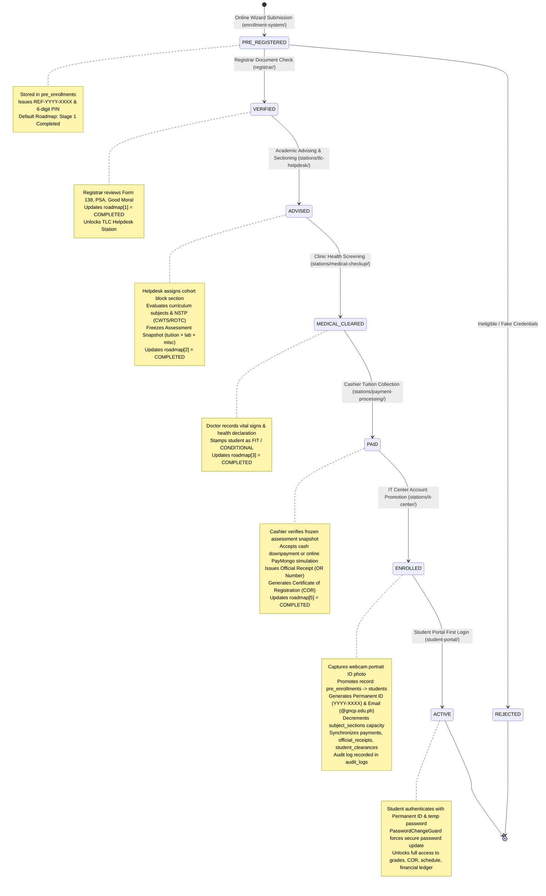
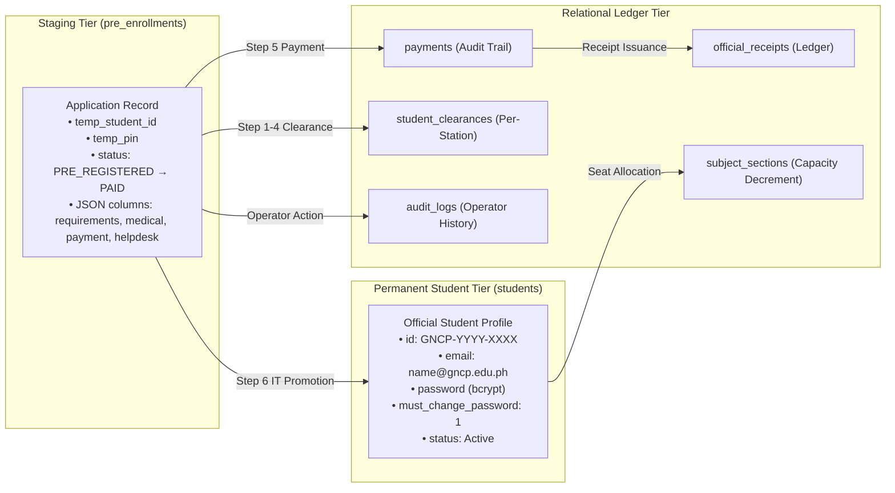
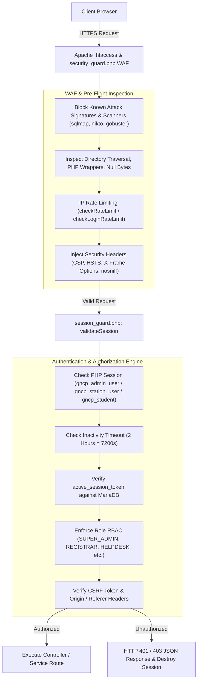

# GNCP Academic & Enrollment Management System
## System Architecture & Data Flow Overview

**System Name:** Go-on National College of the Philippines (GNCP) Academic, Admissions & Workstation Enrollment System  
**Codebase Root:** `c:\xampp\htdocs\systemtest`  
**Architecture Style:** Service-Oriented Web Application / Modular Multi-Portal Monolith (Dual-Gateway REST + Vue 3 Progressive Enhancement)  
**Target Platform:** Apache 2.4.x / PHP 8.2.x / MariaDB 10.4+ (XAMPP & InfinityFree deployment targets)  

---

## 1. High-Level Enterprise Topology

The GNCP Academic Management System operates as an integrated multi-portal academic ERP platform. It decouples applicant intake, on-campus physical workstation clearance operations, student self-service functions, and super-administrative oversight into dedicated presentation modules while unifying data persistence and business logic through a central PHP service layer and MariaDB database.

```mermaid
graph TD
    subgraph ClientPresentation["1. Client Presentation Layer (Vue 3 Progressive Enhancement + HSL Design Tokens)"]
        PublicLanding["Public Portal<br/><code>school-website/index.html</code>"]
        EnrollmentWizard["Online Pre-Reg Wizard<br/><code>enrollment-system/index.html</code>"]
        StatusTracker["Applicant Status Tracker<br/><code>enrollment-system/tracker.html</code>"]
        EmployeeGateway["Staff Login Gateway<br/><code>index.html</code>"]
        RegistrarPortal["Registrar Workstation<br/><code>registrar/index.html</code>"]
        HelpdeskPortal["TLC Helpdesk Advising<br/><code>stations/tlc-helpdesk/index.html</code>"]
        MedicalPortal["Clinic Medical Screening<br/><code>stations/medical-checkup/index.html</code>"]
        CashierPortal["Cashier Billing & OR<br/><code>stations/payment-processing/index.html</code>"]
        ITCenterPortal["IT Center Promotion<br/><code>stations/it-center/index.html</code>"]
        StudentPortal["Student Self-Service Hub<br/><code>student-portal/index.html</code>"]
        AdminPortal["Super Admin Master Console<br/><code>admin/index.html</code>"]
        SecurityConsole["Security & Radar Console<br/><code>monitoring/index.html</code>"]
    end

    subgraph EventAndSyncLayer["2. Real-Time Client Synchronization"]
        DataBus["DataBus.js / StationDataBus.js<br/>(3s Polling + ETag 304 + LocalStorage + Storage Events)"]
        GuardScripts["Session & Password Guards<br/>(session_guard.js, PasswordChangeGuard.js)"]
    end

    subgraph GatewayLayer["3. Unified API & Middleware Gateways"]
        CentralGateway["Canonical REST Gateway<br/><code>api/index.php</code>"]
        LegacyAdapters["Legacy Station/Portal Adapters<br/>(stations/backend/api.php, registrar/backend/api.php, etc.)"]
        SecurityWAF["Web Application Firewall & Guards<br/>(security_guard.php, rate_limit.php, session_guard.php)"]
        TelemetryLogger["Telemetry & Diagnostic Logger<br/>(telemetry.php, logger.php)"]
    end

    subgraph ServiceLayer["4. Domain Business Logic Services Layer"]
        AuthCtrl["AuthController.php"]
        StudentCtrl["StudentController.php"]
        StationCtrl["StationController.php"]
        AdminCtrl["AdminController.php"]
        PortalCtrl["StudentPortalController.php"]
        EnrollService["EnrollmentService.php"]
        AssessService["AssessmentService.php"]
        QueueService["QueueService.php<br/>QueueHydrationService.php"]
        PayMongoService["PayMongoService.php"]
        EmailService["EmailService.php<br/>SocketSmtpTransport.php"]
        AnalyticsService["AnalyticsService.php"]
    end

    subgraph PersistenceLayer["5. Dual-Table MariaDB Persistence Engine (gncp_portal)"]
        PreEnrollments[("Staging Ledger<br/><code>pre_enrollments</code>")]
        Students[("Official Directory<br/><code>students</code>")]
        StationUsers[("Staff Accounts<br/><code>station_users</code>")]
        RelationalLedger[("Financial & Clearances<br/><code>payments</code>, <code>official_receipts</code>, <code>student_clearances</code>")]
        AcademicCatalog[("Academic Catalog<br/><code>programs</code>, <code>subjects</code>, <code>curriculum</code>, <code>sections</code>, <code>fee_schedule</code>")]
        AuditTrail[("System Audit Trail<br/><code>audit_logs</code>, <code>telemetry.log</code>")]
    end

    ClientPresentation --> EventAndSyncLayer
    EventAndSyncLayer --> CentralGateway
    EventAndSyncLayer --> LegacyAdapters
    LegacyAdapters --> CentralGateway
    CentralGateway --> SecurityWAF
    SecurityWAF --> TelemetryLogger
    SecurityWAF --> ServiceLayer
    ServiceLayer --> PersistenceLayer
```

---

## 2. Workstations Sequential Pipeline & State Machine

The student onboarding lifecycle is governed by an explicit 6-stage finite-state machine (FSM). An applicant begins in `pre_enrollments` staging and advances through strict sequential workstation approvals before promotion into the permanent `students` table.

---

## 3. End-to-End Data Flow Lifecycle Traces

### Workflow 1: Public Applicant Online Registration
1. **User Action:** Prospective freshman fills out the 5-step registration wizard at `enrollment-system/index.html`.
2. **Frontend Validation:** Vue 3 reactive model validates mandatory fields (Name, Birthdate, Gender, Course, SHS track, contact info).
3. **API Request:** `POST /api/index.php?action=student/register` (or legacy `enrollment-system/backend/register.php`).
4. **Middleware:** 
   - `security_guard.php` checks for malicious script injection and scanner signatures.
   - `rate_limit.php` enforces a limit of 5 registration attempts per IP per 60 seconds.
5. **Backend Processing:** `StudentController::register()` delegates to `StudentModel::createPreEnrollment()`.
6. **Database Mutation:**
   - Generates collision-free tracking reference: `REF-2026-XXXX`.
   - Generates random 6-digit numeric PIN: `sprintf('%06d', random_int(100000, 999999))`.
   - Initializes 7-step JSON roadmap in `pre_enrollments.roadmap`.
   - Sets status to `PRE_REGISTERED`.
7. **Response Payload:** Returns JSON `{ success: true, data: { referenceNumber: "REF-2026-1001", pin: "123456", studentName: "..." } }`.
8. **Frontend State & UI:** Displays a modal containing the printable registration voucher with QR code and application summary.

---

### Workflow 2: Workstation Live Queue Polling & Zero-Page-Refresh Reflection
1. **Polling Trigger:** `StationDataBus.js` runs a background timer (`setInterval`) every 3,000 milliseconds.
2. **API Request:** `GET /api/index.php?action=stations/queue` with `If-None-Match: "etag_hash"`.
3. **Backend Optimization:** `QueueService::getQueueHash($pdo)` computes a lightweight table checksum across active statuses in `pre_enrollments` and `students`.
4. **HTTP 304 Caching:** If database state has not changed, the server immediately returns `HTTP 304 Not Modified` (0 bytes payload, <2ms response time).
5. **Data Hydration (On Change):** If checksum changed:
   - `QueueService::fetchQueue()` queries active applications from `pre_enrollments` and `students`.
   - `QueueHydrationService::mergeStudentRecords()` joins and deduplicates dual-table records.
   - Attaches curriculum subject lists, block sections, and fee breakdowns.
   - Returns full JSON array.
6. **Frontend Event Dispatch:** Client compares payload with `localStorage.getItem('gncp_enrollment_queue')`. If different:
   - Updates `localStorage`.
   - Fires `window.dispatchEvent(new Event('storage'))`.
   - All open workstation browser tabs re-render reactively without requiring a browser refresh.

---

### Workflow 3: Cashier Payment Processing & Assessment Freezing
1. **User Action:** Cashier searches student by Reference Number or scans applicant barcode at `stations/payment-processing/index.html`.
2. **Validation:** `PaymentService::validatePaymentEligibility()` verifies that status is not `PRE_REGISTERED`, `REJECTED`, or missing `MEDICAL_CLEARED`.
3. **Assessment Calculation:** `AssessmentService::calculateAssessment()` loads the advised subjects and applies the authoritative fee schedule from `fee_schedule`:
   $$\text{Tuition Fee} = \text{Total Units} \times \text{Tuition Rate per Unit}$$
   $$\text{Cash Total} = \text{Tuition Fee} + \text{Lab Fees} + \text{Misc Fees} + \text{LMS} + \text{OMR} + \text{NSTP} - \text{Discount}$$
   $$\text{Installment Total} = \text{Cash Total} + (\text{Cash Total} \times 0.08)$$
4. **Payment Submission:** Cashier enters Amount Paid, Payment Mode (`CASH`, `INSTALLMENT`), Channel, and issues Official Receipt Number (`OR-YYYY-XXXXX`).
5. **API Mutation:** `POST /api/index.php?action=stations/update` with `updateData: { payment: { ... }, status: "PAID" }`.
6. **Transactional Persistence (`EnrollmentService.php`):**
   - `$pdo->beginTransaction()`
   - Locks record: `SELECT id FROM pre_enrollments WHERE temp_student_id = :ref FOR UPDATE`.
   - Updates `pre_enrollments.payment_data`, `or_number`, and sets `status = 'PAID'`.
   - Inserts record into `payments` table.
   - Inserts record into `official_receipts` table.
   - Inserts cashier clearance into `student_clearances`.
   - Inserts action record into `audit_logs`.
   - `$pdo->commit()`
7. **UI Outcome:** Enables the "Print Official Receipt" and "Print COR" buttons (`receipt_print.php`, `cor_print.php`).

---

### Workflow 4: IT Center Final Promotion & Student Account Provisioning
1. **User Action:** IT Center Officer selects a student with status `PAID` at `stations/it-center/index.html`.
2. **Webcam Capture:** Officer captures applicant photo portrait via WebRTC `getUserMedia()`, converted to Base64 PNG.
3. **API Upload:** `POST /api/index.php?action=upload_photo` saves image to `uploads/portraits/` with MIME and magic-byte validation.
4. **Promotion Request:** `POST /api/index.php?action=stations/update` with `updateData: { enrollment: { status: 'ENROLLED', assignedSection: 'BSIT-1A' } }`.
5. **Atomic Database Mutation (`promotePreEnrollmentToStudent` in `student.php`):**
   - Allocates permanent student ID: `generateUniqueStudentId($pdo, '2026')` $\rightarrow$ `2026-1001`.
   - Generates institutional email: `first.lastNN@gncp.edu.ph`.
   - Hashes default password (student's lowercase last name) via `password_hash($plain, PASSWORD_DEFAULT)`.
   - Inserts permanent record into `students` table with `must_change_password = 1`.
   - Decrements class capacity in `subject_sections`: `capacity = GREATEST(0, capacity - 1)`.
   - Updates staging status in `pre_enrollments` to `PROMOTED` (preserving audit history).
   - Inserts IT Center clearance in `student_clearances`.
   - Records audit event in `audit_logs`.
6. **UI Outcome:** Displays the student's permanent ID card, temporary credentials, and triggers automated email dispatch via `EmailService.php`.

---

## 4. Multi-Station Data Synchronization & Storage Architecture

---

## 5. Security & Session Lifecycle Topology

